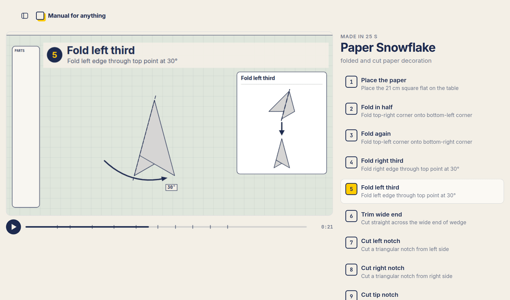
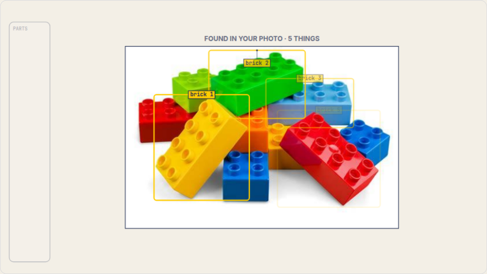
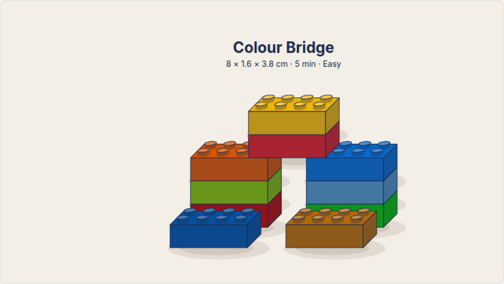
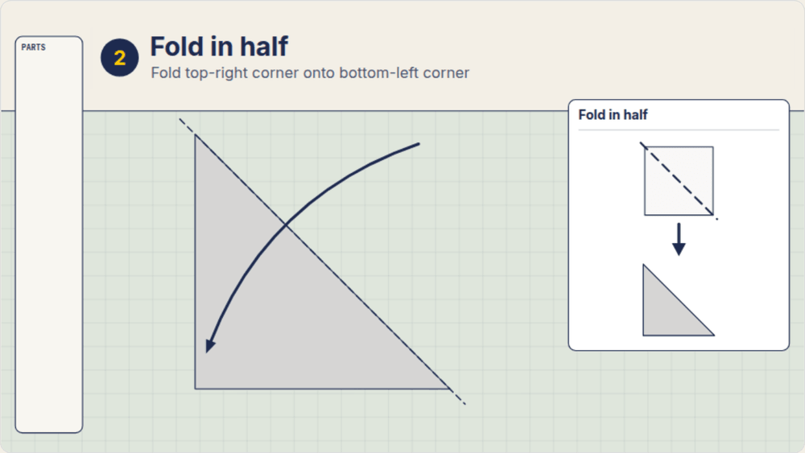
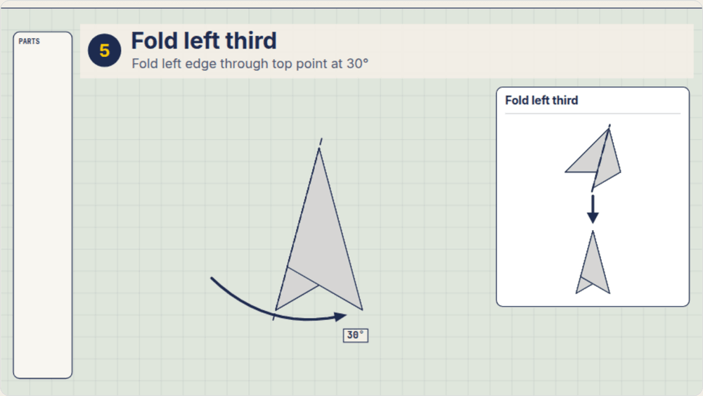
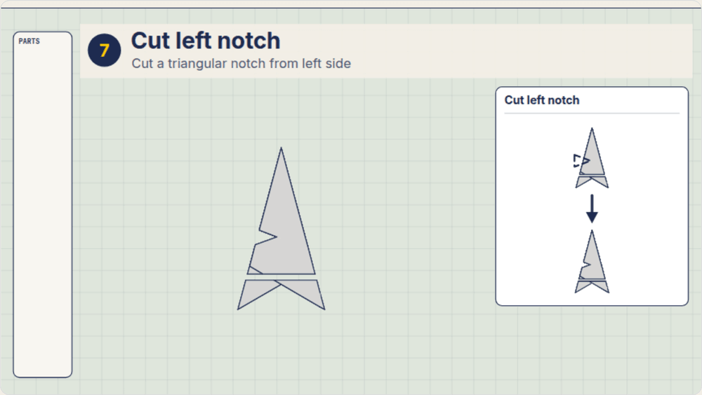
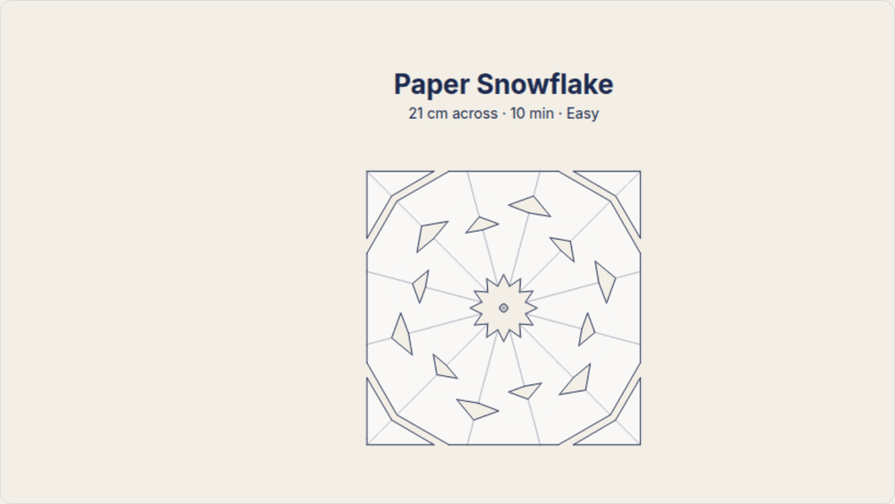
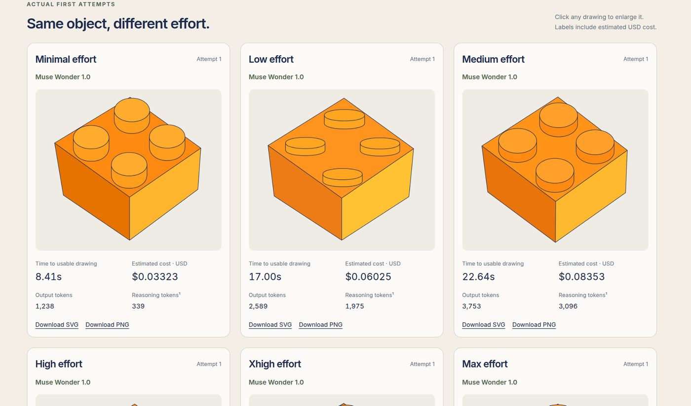

# Manual for Anything

Take a photo of what you have, and get plain, IKEA-style instructions for making something from it, animated in your
browser. Built for Meta's Global AI Developer Hackathon 2026, in the Build for your World theme.



## Run locally

You need [Node.js 24 or newer](https://nodejs.org). It works the same on Windows, macOS and Linux.

```sh
npm install
npm start
```

Open <http://localhost:8080/examples> to watch saved manuals, including the **Colour Bridge** and
**Paper Snowflake**. No API key needed.

To make manuals from your own photos, run this instead. It asks for your Meta Model API key the first time and saves it
in `.env.local`. Uploads make paid API calls.

```sh
npm run live
```

## What it makes

The model decides what to make and writes the steps. Solvers then work out the exact geometry for each kind of material,
so a fold or a brick lands where the numbers say it should. These are real frames from the saved examples.

| | |
| --- | --- |
|  |  |
| **It starts from your photo.** It finds what's useful in the picture and cuts each thing out. | **Bricks** sit on a stud grid, and each one must rest on the studs below it. |
|  |  |
| **Paper folds** are calculated layer by layer, so each one lands exactly where it should. | **Captions and labels carry the numbers**, such as a fold's angle. |
|  |  |
| **Cuts go through every layer** of the folded sheet. | **The unfolded pattern follows from the folds**, so the result is worked out rather than drawn by hand. |

Both of these come from saved generation runs.

### What each solver understands

| Material | What it works out |
| --- | --- |
| **Bricks** | Placement by stud, including slopes, round bricks, plates, tiles, grilles and studs on the side; a check that each brick rests on at least one stud |
| **Paper and other sheets** | Valley and mountain folds, creases, turning over, cuts through layers, opening out |

## Using it

- **Add a note with your photo.** Share ideas, tools you own or constraints, such as "no power tools".
- **Watch it being made.** A live log shows what was found and each stage as it finishes. Extras like the reference
  diagrams and the finale arrive while you watch, and the film picks them up from where you are.
- **Move through the film at your own pace.** Scrub the timeline, or click a step to jump to it.
- **Revise it in plain words.** For example: "That's fabric, not paper. Make a no-sew version."
- **Pick another idea.** Each photo also gets a catalogue of up to 20 other projects, with time, level and materials.
  Choosing one makes a new film from the same cut-outs.
- **Adjust the drawings.** Hide layers or recolour them if a drawing isn't quite right.
- **Use it from your phone.** Take the picture directly, and find your saved projects in the sidebar.

Revising, retrying and new ideas need `npm run live`, because they make paid calls.

## How it works

| Step | Model | What it does |
| --- | --- | --- |
| Recognize | Muse Wonder, minimal effort | Lists the objects in the photo |
| Segment | SAM 3.1 | Cuts each object out of the photo |
| Plan | Muse Wonder, minimal effort | Designs the project and writes structured steps, which are validated and repaired |
| Draw | Muse Wonder, minimal effort | Turns each cut-out into a vector drawing |

Deterministic solvers then work out the geometry from the plan, and a fixed engine animates every step. Films play on a
browser canvas, with model-written drawing code running in a sandboxed iframe. Written problems skip segmentation and go
straight to an explanation.

### Keeping it correct and safe

- **Plans are checked before anything is drawn.** Each plan must meet a versioned contract covering its operations,
  materials and joints. If it breaks the rules, the model is told what's wrong and repairs it.
- **Measurements aren't guessed.** Solvers never stretch a part to fit, and they don't infer amounts or temperatures from
  how something looks.
- **Generated code is treated as untrusted.** The player runs in a sandboxed iframe with a strict content security
  policy. The app hands it everything it needs, and it can't fetch anything itself.
- **Films are tested without paid calls.** Nearly 400 offline tests cover the solvers, pipeline and server.
  `node scripts/frames.mjs --all` also checks a set of saved films for clipped parts, overlapping labels, tools that never
  appear and caption numbers the film doesn't show.

The steps can still be wrong, because the model can misidentify something or make a mistake. Check materials, measurements
and equipment instructions before following them. Reverse and squash folds aren't supported yet.

### Tested, not assumed

The app includes the comparisons behind our model settings, with the real output, time and cost of each attempt. Open
<http://localhost:8080/comparisons> while it's running to see drawings, or `/comparisons/plans` to see plans.



**Why minimal effort for drawing?** More thinking didn't reliably make better drawings. In our comparison, Muse Wonder
sometimes drew better at minimal effort: its rope kept the open loops that max effort filled in, and its scissors had
cleaner handles. Minimal took 8–15 s and about $0.03–0.05 per drawing, against 22–38 s and $0.08–0.12 at max. Each effort
level has one attempt per object, so this shows examples, not a success rate.

[MIT license](LICENSE). Bundled fonts use the SIL Open Font License.
